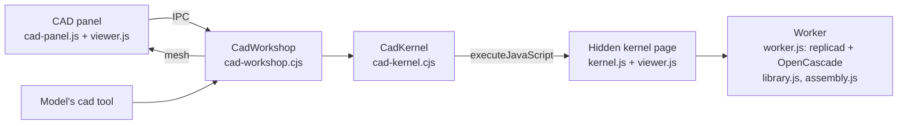

# CAD workshop

The CAD workshop is an optional built-in plugin for designing small parts with Little Bot. It is off until the user switches it on in **Extensions › Tools › Built-in plugins**. While it is off there is no panel, no engine page and no `cad` tool in any prompt. While it is on, a conversation gets the `cad` tool only once it is loaded there, by the model through `plugin_load` or by the user using the panel (see [Optional plugins load on demand](10-agent-tools-terminal.md#optional-plugins-load-on-demand)).

## How it fits together

- **A part is a script** in the working folder, `cad/<name>.cad.js`: `const params = {...}` (numbers become sliders, true/false switches) and `function main(p)` returning a solid. Every replicad function is in scope, and so are the workshop's own helpers (see [The workshop's helpers](#the-workshops-helpers)). [CadWorkshop](../../src/cad-workshop.cjs) saves each version as `data/cad/projects/<id>/v<n>.js` (200 kept), notes who made it (the user or Little Bot), and remembers the open part.
- **The engine** is [replicad](https://replicad.xyz) 1.1.0 on OpenCascade 7 compiled to WebAssembly (`replicad_single.wasm`, 22 MB). [CadKernel](../../src/cad-kernel.cjs) runs it in a hidden, offscreen, sandboxed page with its own session. That session serves only the app's CAD files and libraries through the `little-bot-cad://app/` protocol and cancels every other request, so a part's script reaches neither the network nor the disk, with two read-only exceptions: `/fonts/<family>?style=` serves an installed font found by [cad-fonts.cjs](../../src/cad-fonts.cjs) in the Windows font registry (.ttf and .otf; collections are left out), and `/import/<name>` serves a STEP or STL file from the working folder's `cad` folder or the working folder itself, never outside it, up to 64 MB. Permissions and downloads are refused. The script runs in a [worker](../../src/cad/worker.js) of that page; a script still running after its time limit (120 s for a build) is stopped by replacing the worker. replicad does not free the shapes a script drops, so each build reports the engine's memory and [kernel.js](../../src/cad/kernel.js) starts a fresh worker before the next build once it passes 1.2 GB. The page starts when the panel opens or the model first uses the tool, about a second on this PC, and closes with the main window.
- **The view** is [viewer.js](../../src/cad/viewer.js) on three.js 0.186.1, shared by the panel (interactive: drag to turn, right-drag or Shift-drag to move, wheel to zoom) and the kernel page (pictures for the model). Z points up; faces and edges keep the engine's numbers, so a click names exactly what was clicked.

## A build

[worker.js](../../src/cad/worker.js) `run`:

1. Finds syntax errors with acorn, so they name their line.
2. Loads what the script names as plain text: fonts in `text()` calls and files in `importPart()` calls ([library.js](../../src/cad/library.js) `wanted`), kept between builds; an imported file is read again when its size or date changes.
3. Runs the script with replicad's functions and the workshop's helpers in scope. Every call that makes or changes a solid (makeBox, makeCylinder, extrude, revolve, fillet, chamfer, shell, cut, fuse, ...) records its script line and a copy of its result; moves keep the line that made the shape. OpenCascade failures arrive as C++ exceptions without a JavaScript stack, so the last recorded call names the line, and fillet and chamfer failures say what usually went wrong.
4. Meshes the part (tolerance from its size) and its edges, renumbering the mesher's hash codes to face and edge indexes.
5. Measures size, volume, area and pieces, and checks the part.

**Checks** (limits in the Checks tab, saved in `state.json`):
- not a closed solid, or several separate pieces;
- walls thinner than the minimum (0.8 mm by default): rays cast into the material from points on a coarse mesh. In a part with threads, the swept faces are left out, as a thread's crests are thin by design;
- holes narrower than the minimum (1 mm): cylindrical faces whose material is outside;
- overhangs steeper than 45° that would need supports when printed this way up (can be turned off).

**Faces and edges** (`face`, `edge`): type, size, diameter of round ones, axis-aligned planes, and the script line that made them: the earliest recorded step whose own faces contain the point (OpenCascade's closest-point tool puts the point exactly on the face). Each also comes with a ready finder, for example `(e) => e.containsPoint([12, -5, 4])`, that the model can pass to fillet, chamfer or shell.

**Exports**: STEP (exact geometry), binary STL, 3MF (welded mesh in a zip), and SVG or DXF of the top view for laser cutting, in millimetres.

## The model's tool

`cad` ([CadWorkshop.call](../../src/cad-workshop.cjs)) works only in the user's own running conversation or a scheduled task, never in goals or heartbeat; Plan mode keeps it. Actions: `guide` (returns [GUIDE.md](../../resources/cad/GUIDE.md): the script shape, the API, the helpers, finders and examples), `read`, `write` (a new version of the whole script), `set` (slider values), `view` (a picture: four standard views in a grid by default, optionally with a `pose` and `explode`), `pose` (a picture with joints moved, and what runs into what there), `bom` (the bill of materials), `inspect`, `measure`, `export`, `open`, `revert`. A view or inspect can name up to 200 faces or edges. `write`, `set`, `open` and `revert` return the size, the checks and a picture, so the model sees what it built. A new script clears slider values and says which ones were dropped.

## The workshop's helpers

[library.js](../../src/cad/library.js) adds these to a script's scope; each is one traced step of the script (its own inner steps are not recorded):

- **ISO metric threads and fasteners** (M2 to M20, or any diameter with a pitch): `thread`, `bolt` (socket, hex, button or countersunk head), `nut`, `washer`, and cutting tools for `boltHole` (ISO 273 clearance with a counterbore or countersink), `threadedHole`, `tapHole`, `nutTrap` and `insertHole`. Sizes are nominal; a `clearance` option adds room on the diameter only when the script asks for it. A thread is the ISO profile swept along a helix (Frenet) and fused to its core, then trimmed. OpenCascade needs care here: the helix starts at z = 0 and makes whole turns, a long helix is swept in pieces of at most 20 turns, the core's and trim's seams are turned away from the coil's ends, and up to three more attempts follow a failure, with more pieces, a turn more or the seams elsewhere. A countersunk head's cone starts from the thread's core (meeting the crests edge to edge, the fuse fails), and a bolt that still comes out in two pieces is refused. Shanks and hole tools reach past the faces they meet, so nothing only touches. A thread takes a few seconds.
- **Patterns**: `linearPattern`, `gridPattern`, `polarPattern` and `mirrorCopy` return the copies as one compound; `fuseAll` and `cutAll` combine lists.
- **Text**: `text(string, { size, height, font, bold, italic, align, valign })` with replicad's `drawText` on a font from this PC.
- **Imported parts**: `importPart(name)` with replicad's `importSTEP` and `importSTL`.
- **Assemblies**: `hinge`, `slider` and `attach` (below); materials and their densities.

## Several parts and assemblies

A script can return several named parts, placed as they go together: `return { box, lid }`, or a list of `{ name, shape, color }`. A single shape is one part called "part", so older scripts work unchanged. Names are letters, digits, spaces, dots, dashes and underscores, up to 40, each used once. There can be up to 200 parts, and the same shape can't be two parts. An entry may add `material` (its weight follows from the density), `count`, `bought: true` (hardware: in the bill of materials and the STEP assembly, not in the print files or the print layout) and `joint`.

- **One model, tagged:** [worker.js](../../src/cad/worker.js) builds a compound of the parts, so face and edge numbers stay global. Every face and edge group in the mesh carries the index of its part, matched by OpenCascade's hash codes, since the compound holds the parts' own faces. Faces and edges also name their part when inspected.
- **Checks per part:** volume and separate pieces are checked within each part, so a box and its lid are not "two loose pieces". Thin-wall rays only meet their own part, so the gap to another part is not a thin wall. Overhangs are measured from each part's own lowest point, as each part is printed on its own.
- **Overlaps between parts** are errors, with their volume. Gaps are not judged: room for printing is the script's business, so there is no clearance limit. The exact intersection is slow where two parts share a curved surface (a bolt in its threaded hole: half a minute), so the view mesh decides first. About 12 000 points spread over one part's surface by area are pushed just inside it and tested for being inside the other part, with rays along X and Y counting crossings through a grid of the other part's triangles. A point counts only if it stays inside however it is nudged by the mesh's precision, and only 8 or more points make a pair worth intersecting exactly.
- **Joints** ([assembly.js](../../src/cad/assembly.js), shared by the engine and the view): `hinge({ axis, origin, min, max, value, parent })` turns a part in degrees, `slider({ axis, min, max, value, parent })` moves it in millimetres, and `attach(parent)` only fixes it to another part. Joints are written in the assembled positions; a pose applies a part's own joint, then its parent's, and so on. Unknown parents, loops and empty ranges are script errors. Each moving joint is swept through 9 positions of its range with the others at rest, and a part it moves that runs into another is an error naming the range where it happens (pairs that already overlap at rest are reported once, as an overlap). Up to 200 exact intersections are spent on this; past that the check says it covered only part of the movement. The `collide` operation answers the same for one pose.
- **Print layout:** each printed part gets an offset that puts its lowest point on the bed, side by side along X with a gap, the row centred on the origin. Bought parts get none and are hidden in the print layout.
- **Exports of all parts:**
  - STL, 3MF, SVG and DXF use the print layout and leave bought parts out (unless every part is bought). In the 3MF each part is its own named object with a display colour.
  - STEP keeps the parts in place, as a named, coloured assembly (replicad's `exportSTEP`).
  - The `part` option exports one part, as `<name>-<part>.<format>` by default.
- **The panel:**
  - a strip of the parts' colours and names: a click shows only that part (again shows all), and the − and + buttons hide and show one;
  - an **Assembled / Print layout** switch;
  - an **Assembly** tab: a slider for each joint and one to explode the parts, both in the view only, and the bill of materials with quantities, materials, solid weights and sizes. A motion problem's **Show** moves the joint to where it happens;
  - an "Export: All parts / one part" choice in the export menu;
  - chips and the size line that name the part.

  The view moves each part by a matrix (its print-layout place, or its pose plus the explosion). Points clicked in a moved part are kept in assembled coordinates, so pins and the engine agree. Colours come from [colors.js](../../src/cad/colors.js), shaded for the dark theme. Pictures for the model have a legend of the parts.

## Pointing at the part

The panel ([cad-panel.js](../../src/renderer/cad-panel.js)) has three click modes:

- **Select**: a face or edge, with Shift to add more. Its script line lights up in the Script tab.
- **Pin**: a numbered pin with a note.
- **Measure**: two clicks give the distance, and the angle between two flat faces.

A problem's **Fix** button in the Checks tab or on a script error adds it as well. Everything pointed at waits as numbered chips in the composer, each with an optional note, and goes with the next message (`send({ cad: { items } })`). [Controller.send](../../src/controller.cjs) asks the workshop for a numbered text block (face type, size, script line, finder, note) and a picture with the same numbers, attached as an image when the model accepts images. The user message keeps short labels that the timeline shows under it. Selections that name faces or edges are dropped when a new version builds, since the numbers change. Pins and measurements stay.

The **Settings** tab tries values without touching the script. The model sees them with the next message and is asked to keep them. **Versions** lists every version; **Compare** shows an older one faintly over the current one (the last four builds are kept), and **Restore** makes it current as a new version.

## Verification

- [cad-kernel-electron.cjs](../../test/cad-kernel-electron.cjs) runs the real engine in Electron:
  - a filleted bracket with two holes, every face traced to its line;
  - the checks catching a loose piece, a 0.8 mm hole and 0.6 mm walls;
  - every export, and a picture with a pin;
  - syntax and OpenCascade errors located;
  - `fetch` and `require` refused, and an endless script stopped with the engine coming back;
  - every example in GUIDE.md building one solid per part with no error, with the guide's claims about `shell` and `revolve` checked;
  - several parts:
    - faces tagged with their part;
    - no "pieces" error and no thin wall between parts;
    - the box and lid noted as touching;
    - the print layout;
    - a STEP assembly with names, a 3MF with an object per part, and one part's STL;
    - a 2 mm overlap reported as 200 mm³; a tight gap not judged, and a lip pushed into the wall reported;
    - a custom colour;
    - bad and repeated names refused;
  - a block with a threaded hole, a counterbored hole, a nut trap and an insert hole, with its hex bolt (size checked) and a threaded nut: no overlap, no thread crests as thin walls, the bolt and nut off the print bed and out of the 3MF;
  - threads from M2 to M12, each one solid of its diameter;
  - polar and grid patterns, embossed text, and a missing font named;
  - a STEP file imported from the working folder and cut, a missing file named and one outside the folder refused;
  - an assembly with a hinge, a slider and an attached post: the slider running into the post near the end of its travel, a pose with and without a collision, a posed and exploded picture, loops and unknown materials refused.
- [cad-assembly.test.cjs](../../test/cad-assembly.test.cjs) covers the joint checks and pose math, materials and thread sizes, what a script needs loaded, the bill of materials and poses through the tool, fonts read from the registry, and the engine page serving only STEP and STL files inside the working folder.
- [cad-workshop.test.cjs](../../test/cad-workshop.test.cjs) covers, with a stand-in engine:
  - versions and reverting, sliders, and errors;
  - the tool's gating;
  - the message context;
  - several parts in the summary, one part's export and its file name, and the part named in what the user points at.
