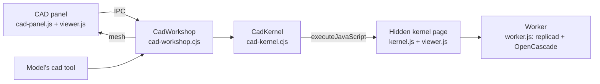

# CAD workshop

The CAD workshop is an optional built-in plugin for designing small parts with Little Bot. It is off until the user switches it on in **Extensions › Tools › Built-in plugins**. While it is off there is no panel, no engine page and no `cad` tool in any prompt.

## How it fits together

- **A part is a script** in the working folder, `cad/<name>.cad.js`: `const params = {...}` (numbers become sliders, true/false switches) and `function main(p)` returning a solid. Every replicad function is in scope. [CadWorkshop](../../src/cad-workshop.cjs) saves each version as `data/cad/projects/<id>/v<n>.js` (200 kept), notes who made it (the user or Little Bot), and remembers the open part.
- **The engine** is [replicad](https://replicad.xyz) 1.1.0 on OpenCascade 7 compiled to WebAssembly (`replicad_single.wasm`, 22 MB). [CadKernel](../../src/cad-kernel.cjs) runs it in a hidden, offscreen, sandboxed page with its own session. That session serves only the app's CAD files and libraries through the `little-bot-cad://app/` protocol and cancels every other request, so a part's script reaches neither the disk nor the network; permissions and downloads are refused. The script runs in a [worker](../../src/cad/worker.js) of that page; a script still running after its time limit (60 s for a build) is stopped by replacing the worker. The page starts when the panel opens or the model first uses the tool, about a second on this PC, and closes with the main window.
- **The view** is [viewer.js](../../src/cad/viewer.js) on three.js 0.186.1, shared by the panel (interactive: drag to turn, right-drag or Shift-drag to move, wheel to zoom) and the kernel page (pictures for the model). Z points up; faces and edges keep the engine's numbers, so a click names exactly what was clicked.

## A build

[worker.js](../../src/cad/worker.js) `run`:

1. Finds syntax errors with acorn, so they name their line.
2. Runs the script with replicad's functions in scope. Every call that makes or changes a solid (makeBox, makeCylinder, extrude, revolve, fillet, chamfer, shell, cut, fuse, ...) records its script line and a copy of its result; moves keep the line that made the shape. OpenCascade failures arrive as C++ exceptions without a JavaScript stack, so the last recorded call names the line, and fillet and chamfer failures say what usually went wrong.
3. Meshes the part (tolerance from its size) and its edges, renumbering the mesher's hash codes to face and edge indexes.
4. Measures size, volume, area and pieces, and checks the part.

**Checks** (limits in the Checks tab, saved in `state.json`):
- not a closed solid, or several separate pieces;
- walls thinner than the minimum (0.8 mm by default): rays cast into the material from points on a coarse mesh;
- holes narrower than the minimum (1 mm): cylindrical faces whose material is outside;
- overhangs steeper than 45° that would need supports when printed this way up (can be turned off).

**Faces and edges** (`face`, `edge`): type, size, diameter of round ones, axis-aligned planes, and the script line that made them: the earliest recorded step whose own faces contain the point (OpenCascade's closest-point tool puts the point exactly on the face). Each also comes with a ready finder, for example `(e) => e.containsPoint([12, -5, 4])`, that the model can pass to fillet, chamfer or shell.

**Exports**: STEP (exact geometry), binary STL, 3MF (welded mesh in a zip), and SVG or DXF of the top view for laser cutting, in millimetres.

## The model's tool

`cad` ([CadWorkshop.call](../../src/cad-workshop.cjs)) works only in the user's own running conversation, never in goals, heartbeat or routines, and is not offered in Plan mode. Actions: `guide` (returns [GUIDE.md](../../resources/cad/GUIDE.md): the script shape, the API, finders and six examples), `read`, `write` (a new version of the whole script), `set` (slider values), `view` (a picture: four standard views in a grid by default), `inspect`, `measure`, `export`, `open`, `revert`. `write`, `set`, `open` and `revert` return the size, the checks and a picture, so the model sees what it built. A new script clears slider values and says which ones were dropped.

## Pointing at the part

The panel ([cad-panel.js](../../src/renderer/cad-panel.js)) has three click modes:

- **Select**: a face or edge, with Shift to add more. Its script line lights up in the Script tab.
- **Pin**: a numbered pin with a note.
- **Measure**: two clicks give the distance, and the angle between two flat faces.

A problem's **Fix** button in the Checks tab or on a script error adds it as well. Everything pointed at waits as numbered chips in the composer, each with an optional note, and goes with the next message (`send({ cad: { items } })`). [Controller.send](../../src/controller.cjs) asks the workshop for a numbered text block (face type, size, script line, finder, note) and a picture with the same numbers, attached as an image when the model accepts images. The user message keeps short labels that the timeline shows under it. Selections that name faces or edges are dropped when a new version builds, since the numbers change. Pins and measurements stay.

The **Settings** tab tries values without touching the script. The model sees them with the next message and is asked to keep them. **Versions** lists every version; **Compare** shows an older one faintly over the current one (the last four builds are kept), and **Restore** makes it current as a new version.

## Verification

- [cad-kernel-electron.cjs](../../test/cad-kernel-electron.cjs) runs the real engine in Electron:
  - a filleted bracket with two holes, every face traced to its line;
  - the checks catching a loose piece, a 0.8 mm hole and 0.6 mm walls;
  - every export, and a picture with a pin;
  - syntax and OpenCascade errors located;
  - `fetch` and `require` refused, and an endless script stopped with the engine coming back;
  - every example in GUIDE.md building one solid, with the guide's claims about `shell` and `revolve` checked.
- [cad-workshop.test.cjs](../../test/cad-workshop.test.cjs) covers, with a stand-in engine:
  - versions and reverting, sliders, and errors;
  - the tool's gating;
  - the message context.
