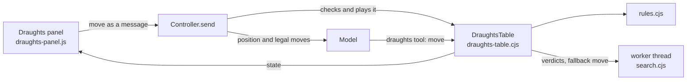

# Draughts

Draughts is an optional built-in plugin for playing international draughts against Little Bot. It is off until the user switches it on in **Extensions › Tools › Built-in plugins**. While it is off there is no board and no `draughts` tool in any prompt. While it is on, the `draughts` tool is offered in every conversation (see [Optional plugins](10-agent-tools-terminal.md#optional-plugins)).

## How it fits together

- **The rules** ([rules.cjs](../../src/draughts/rules.cjs)) are the international ones on a 10×10 board, as played in France:
  - men move forward and capture backwards too;
  - capturing is compulsory, and the sequence that takes the most pieces must be played;
  - pieces taken during a sequence stay on the board until it ends: they cannot be jumped twice and they block the way;
  - kings fly;
  - a man is crowned only if its move ends on the far row.

  Squares are numbered 1–50 from Black's side, as in the usual notation (`32-28`, `19x30`). When two captures share both ends, the notation lists the squares in between. Move generation matches the published counts for the opening position (9, 81, 658, 4,265 and 27,117 positions at depths 1 to 5).

- **Draws** follow the FMJD rules in a simplified form:
  - the same position three times;
  - 25 moves each with only kings moving and nothing taken;
  - with a lone king against at most three pieces, 16 moves each, or 5 when only kings are left, at most two against one.

  A side with no piece or no legal move loses.

- **Each conversation has its own game**, saved in `state.json`: the main conversation under `main`, saved sessions under their id. Quick sessions have none. [DraughtsTable](../../src/draughts-table.cjs) keeps:
  - the twelve most recent games;
  - the positions before the last 40 moves, for taking moves back;
  - the board preferences: level, sound, square numbers and the dots showing where a piece can go.

## A move

1. The user moves on the board, by clicking a piece and then a square, or by dragging. Destinations show as dots. Hovering one shows which pieces it takes. When two captures end on the same square, a small menu asks which pieces to take.
2. The panel shows the move at once and sends it as a message: `send({ draughts: { played } })`. Any text in the composer goes with it as the user's comment.
3. [Controller.send](../../src/controller.cjs) checks the move before accepting the message and plays it once the message is in the timeline. The user message keeps the move, and the timeline shows it under the message.
4. The turn's input gets a **Draughts** block:
   - the colours and the level;
   - the pieces on each side by square;
   - the last moves;
   - on Little Bot's turn, its legal moves and the instruction to play exactly one with the tool, then say a sentence or two.

   The block is also added to ordinary messages while a game is under 30 minutes old and its board is open, so "why did you play that?" has the position.
5. The model plays with the `draughts` tool. A refused move gets the list of legal moves back.

**How much the model is told** depends on the level. A search in a worker thread ([search.cjs](../../src/draughts/search.cjs), alpha-beta with captures searched to the end) gives each legal move a verdict, the material it wins or loses within its horizon:

| Level | What Little Bot sees | Search depth |
| --- | --- | --- |
| Easy | Its legal moves only, and "play casually, like a friendly beginner" | none |
| Medium | Moves that lose material are marked | 5 plies |
| Hard | Every move's verdict, and the strongest marked | 7 plies |

**When the model does not move** in its turn, the board plays for it when the turn ends. On Hard it picks the best move. On Medium it picks one of the three best that lose nothing. On Easy it picks any move that loses nothing, and sometimes any move at all. A note under the board says so. A stopped or failed turn leaves the move to Little Bot, with an **Ask Little Bot to play** button.

## The model's tool

`draughts` ([DraughtsTable.call](../../src/draughts-table.cjs)) works only in the user's own running conversation or a scheduled task, never in goals or heartbeat, and is not offered in Plan mode. Actions:

- `board`: the position and, on its turn, its legal moves with verdicts;
- `move`: play one of its legal moves, only on its turn, once;
- `analyse`: the engine's verdict on one move, on what the piece on a square can do, or on every move of the side to move, for questions about the game;
- `new`: start a game, only when the user asks; it opens the board.

## The panel

[draughts-panel.js](../../src/renderer/draughts-panel.js) and [draughts.css](../../src/renderer/draughts.css):

- **The board** is drawn with CC0 textures:
  - maple for the light squares and the light pieces;
  - a dark wood for the dark squares;
  - rosewood for the frame;
  - a dark table wood for the dark pieces.

  Each square shows its own patch of grain. Pieces have a carved ring and a soft shadow, and kings are stacked and crowned. The wood keeps its colours in both themes; the panel around it follows the theme.
- **Moves** slide square by square along their path. Taken pieces lift off at the end and land on the taker's pile above or below the board.
- **Sounds**, from Kenney's CC0 packs: a wood knock for a move, a heavier one for a capture, chips stacking as the pile grows, and a chip laid down for a crown. A button mutes them.
- **The bar** has New game (colour and level), Take back (the user's last move and Little Bot's reply), the dots, square numbers, sound, and Hide.
- **Right-clicking** a square points at it. The square waits as a chip in the composer and goes with the next message (`draughts: { points }`), described as, for example, "square 28 (the user's man)".
- **Below the board:** the moves so far (those the board chose for Little Bot are in italics), a note from the board, and Resign, which asks for a second click.

Starting as Black asks Little Bot for the first move. Like the CAD workshop, the board is one of the side panels. Opening it puts the browser and the CAD workshop away.

## Verification

[draughts.test.cjs](../../test/draughts.test.cjs) covers:

- the move counts to depth 5;
- backward captures and the most-pieces rule;
- flying kings;
- no crown when a capture only passes over the far row;
- no piece taken twice, over random games;
- typed moves and ambiguous captures;
- the draw rules;
- the search seeing a lost piece;
- a game through the table: the user's move, the tool's move, a refused move, the forced reply, `analyse`;
- what each level tells the model;
- the fallback move and its note;
- taking back;
- a game over;
- the plugin's gating, and one game per conversation;
- the store keeping games and dropping malformed ones.
