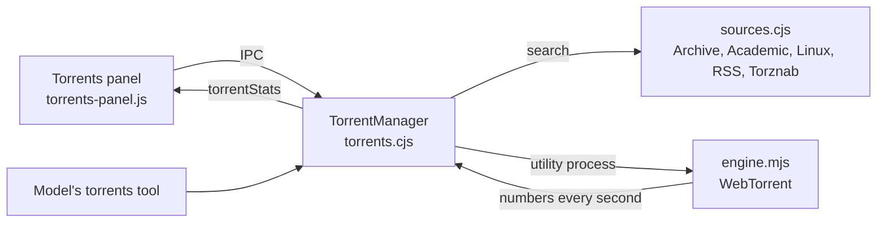

# Torrents

Torrents is an optional built-in plugin: a light BitTorrent client for freely shared content. It is off until the user switches it on in **Extensions › Tools › Built-in plugins**. While it is off, no engine runs and no `torrents` tool is in any prompt. While it is on, a conversation gets the `torrents` tool only once it is loaded there, by the model through `plugin_load` or by the user using the panel (see [Optional plugins load on demand](10-agent-tools-terminal.md#optional-plugins-load-on-demand)).

## How it fits together

- **The engine** ([engine.mjs](../../src/torrents/engine.mjs)) is WebTorrent 3 in an Electron utility process, so hashing pieces and talking to peers never slows the window. It speaks BitTorrent over TCP and µTP, and uses DHT, trackers, peer exchange and local discovery. It can open the router port with UPnP or NAT-PMP (a setting). It starts when something is to be transferred or read, and stops with the app.
- **The manager** ([TorrentManager](../../src/torrents.cjs)) keeps the transfers in `state.json`, and each torrent's `.torrent` file in `data/torrents/files`. It decides what runs and stops sharing at the user's limit. It also searches the sources and answers the model's tool.

## Sources

[sources.cjs](../../src/torrents/sources.cjs) searches every enabled source at once. A source that fails is reported apart, without spoiling the others.

| Source | How it is read |
| --- | --- |
| Internet Archive | Its search API, on titles, most downloaded first. Every item has an `_archive.torrent` that the Archive also serves itself, so it always downloads. |
| Academic Torrents | Its whole catalogue as one RSS file, cached for a day and filtered by title. |
| Linux images | Debian's current `bt-cd` and `bt-dvd` folders, Ubuntu's newest long-term release and newest release folders, and Fedora's torrent feed, cached for six hours. |
| RSS or Atom feed (user's) | Each entry's `.torrent` enclosure or link, or its magnet link, matched by title. |
| Torznab (user's) | The standard search API of many catalogues and self-hosted indexers: `/api?t=search&q=…`, with seeders and size from its `torznab:attr` entries. |

Results rank titles holding all the words first (the whole phrase best), then official images, then seeders and date. A Torznab key is sealed with Windows' secure storage (`safeStorage`) and opened only for a search. It never reaches the window.

## Adding a torrent

1. **Reading:** `prepare` reads a search result, a pasted magnet link or `.torrent` address, or a dropped `.torrent` file.
   - A `.torrent` file is read in the engine without the network.
   - A magnet link's file list comes from peers. It is fetched into a private folder (`data/torrents/peek`) that is emptied afterwards, so a cancelled look never touches the download folder.
   - An indexer may answer a `.torrent` address with a redirect to a magnet link, which is followed.
2. **The card:** it shows the name, the files (with boxes to choose), the size, the source and the free space. Programs, scripts, disk images and archives are marked. Download is disabled when there is not enough space (plus 200 MB).
3. **Starting:** `start` saves the `.torrent` file, adds the transfer and schedules it.

**File names are checked twice**, when reading and when starting. A torrent is refused if a name:
- leaves the download folder;
- contains `:` (a drive or an alternate data stream), or `<>"|?*` or control characters;
- ends in a dot or space;
- is a device name like CON or NUL.

## Transfers

| Status | Meaning |
| --- | --- |
| Waiting (`queued`) | Waiting for one of the download slots (3 by default). |
| Downloading | Running in the engine. |
| Sharing (`seeding`) | Complete, and giving back. |
| Done (`finished`) | Sharing stopped at the limit. Share again restarts it. |
| Paused / Failed | Stopped by the user, or by an error, which is shown. |

- **Sharing stops** after giving back as much as the selected files (ratio 1.0, adjustable), after a time, or never. What was sent is added up across runs, since the engine's counters restart with each run.
- **Pause and restart:** pausing removes the torrent from the engine and keeps its files. Resuming adds it again, and the engine checks what is already on disk, so nothing is downloaded twice. Transfers that were running carry on after a restart of the app.
- **Finished:** a "Little Bot · torrents" notice is posted in the conversation, and from there to the desktop and the phone like other notices.
- **Show in folder** reveals the files.
- **Scan** runs Microsoft Defender's `MpCmdRun.exe -Scan -ScanType 3 -File` on them. Exit code 0 is clean, 2 is a threat, and Defender then acts on it as it is set to.
- **Remove** asks whether to keep or delete the files.
- **Slow down for full-screen games** (off by default): while something transfers, a small PowerShell probe asks Windows every 10 seconds whether a full-screen game or app is in front (`SHQueryUserNotificationState`). While one is, transfers drop to 1 KB/s.

## The model's tool

`torrents` ([TorrentManager.call](../../src/torrents.cjs)) works only in the user's own running conversation, never in goals, heartbeat or routines, and is not offered in Plan mode. Actions:

- `search`: numbered results from the user's sources;
- `request`: a result by its number, or a magnet link or `.torrent` address. It never starts a download: it reads the torrent and puts a card at the top of the Torrents panel (opening it), where the user looks inside, downloads or declines. Requests expire after an hour.
- `list`, `pause`, `resume` (by name, key or "all"), and `limits` (KB/s).

The tool's description asks the model not to look for copies of works that are not freely shared.

## Magnet links

With **Open magnet links with Little Bot** on, Little Bot registers itself for `magnet:` links. A link clicked in the browser reaches the running app (or starts it), opens the panel and reads the torrent. It downloads only after the user clicks Download. Turning the setting off removes the registration.

## Verification

- [torrents.test.cjs](../../test/torrents.test.cjs) covers:
  - feeds (enclosures, magnet links, Torznab numbers, Atom);
  - the search ranking, a link listed twice, a failing source, and the Ubuntu folder choice;
  - a transfer through to sharing back and stopping at the ratio;
  - the download slots, pause, resume and remove;
  - the model's search and request with the user's decision, and the tool's gating;
  - the sealed Torznab key;
  - the store;
  - unsafe file names.
- In the app, with a throwaway profile: Debian's 13.7 netinst was found, read and downloaded (756 MB). It was paused at 8% and resumed, and the result matched Debian's SHA512SUMS. The notice was posted, and Remove deleted the file.
